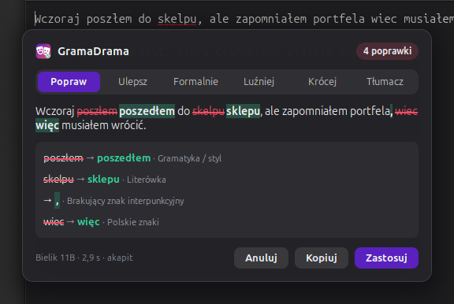
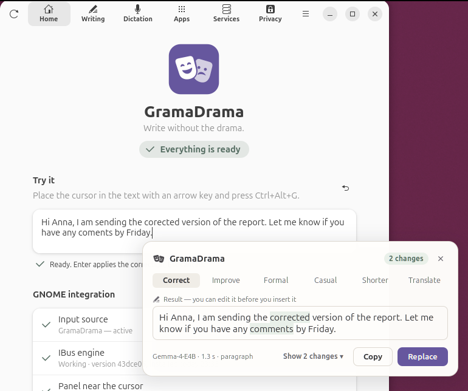
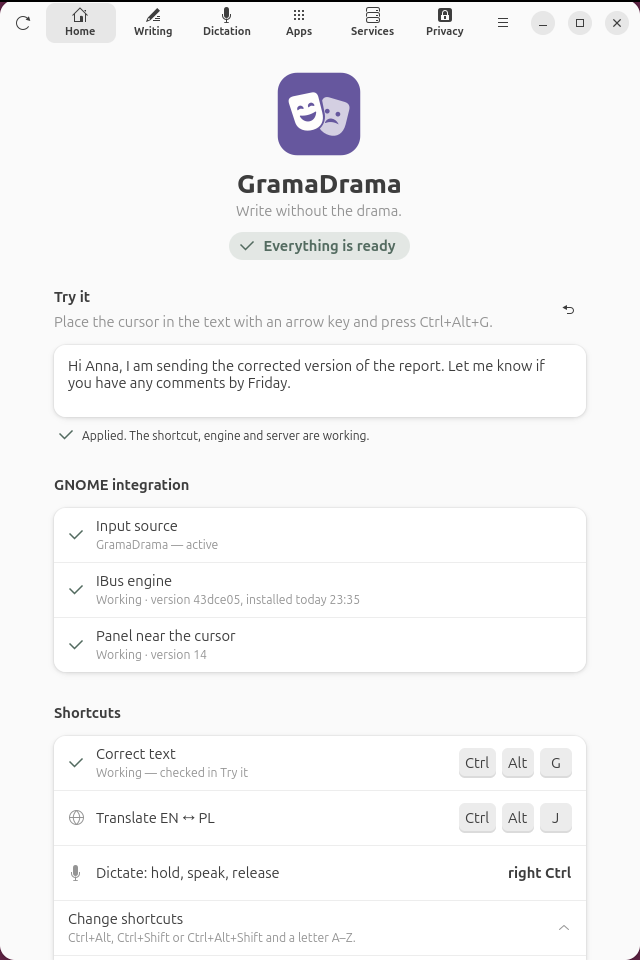
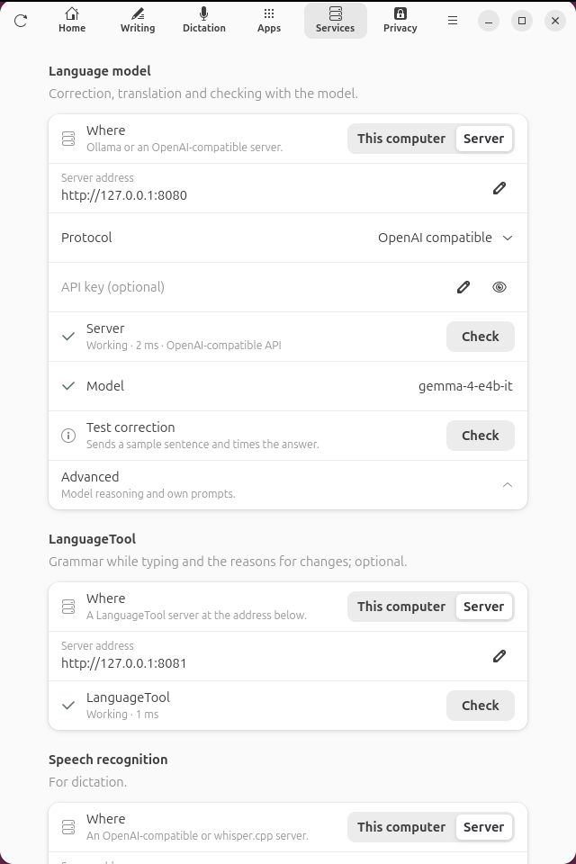
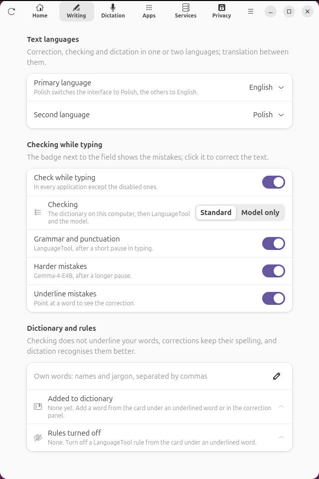
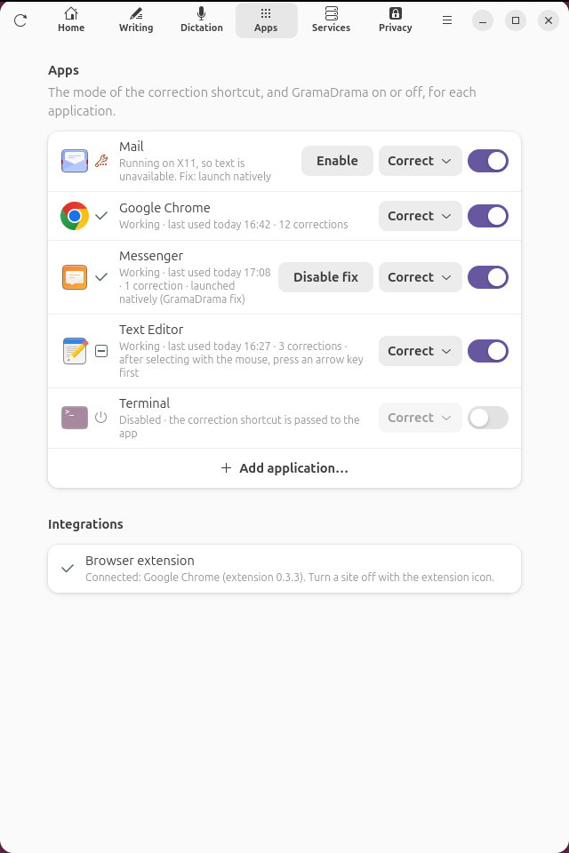
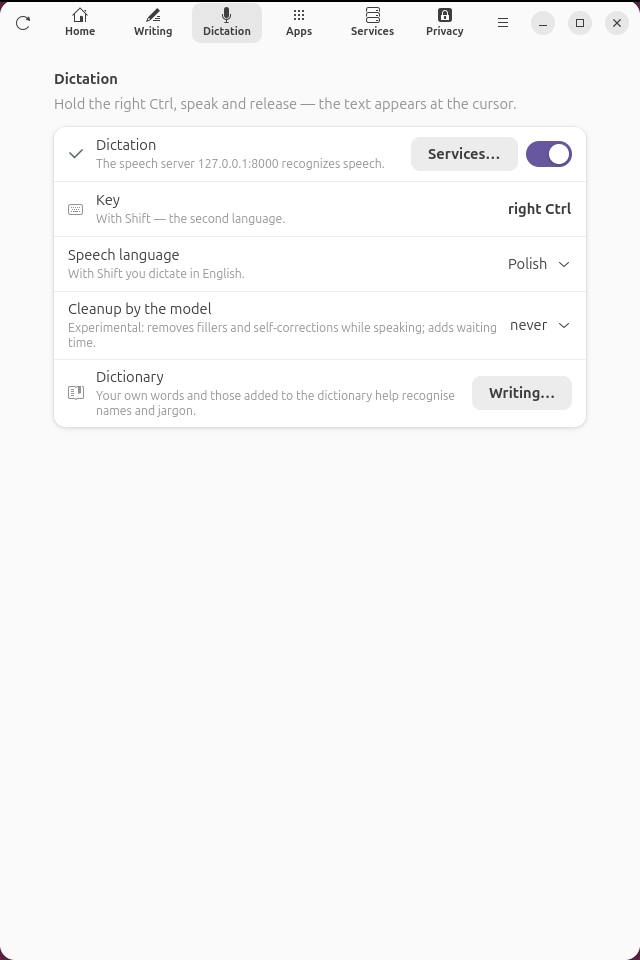
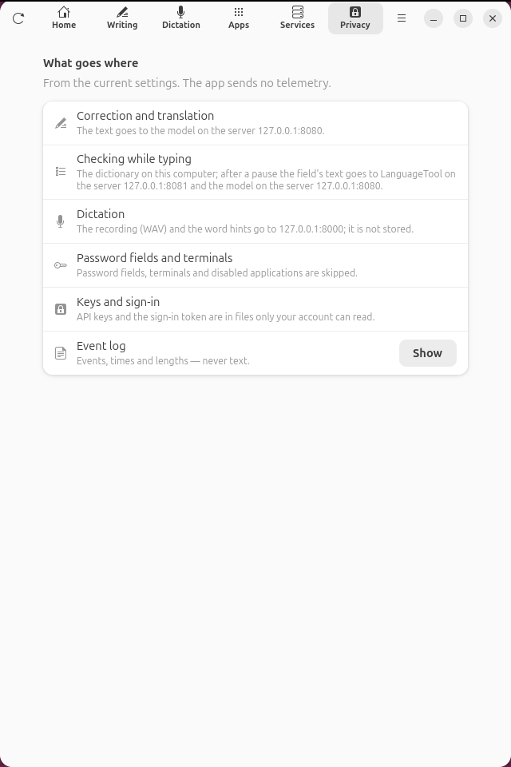

# GramaDrama on Linux

GramaDrama corrects, translates and checks text in supported applications. The GramaDrama IBus
engine opens a panel at the cursor; the result goes into the field once you accept it.
The language model and the optional LanguageTool run at addresses set by the user.
The supported configuration languages are Polish, English and German. The interface is in Polish when
the primary text language is Polish, and in English with any other primary language.



## Installation

The target environment is **Ubuntu 26.04, GNOME 50, Wayland**. The extension declares GNOME 50.
Other GNOME versions, distributions and desktop environments have no confirmed support.
A trial installation on a clean system with someone outside the project remains a condition of the first release.

You need Python 3, PyGObject, IBus, GTK 4 and libadwaita. On Ubuntu these are the packages
`python3-gi`, `gir1.2-ibus-1.0`, `gir1.2-gtk-4.0` and `gir1.2-adw-1`.
Underlines in GTK applications use AT-SPI (`gir1.2-atspi-2.0`).
Spell checking needs Enchant 2 and the dictionaries of the chosen languages.
Dictation needs a working microphone and `pw-record` from PipeWire.

Run from the root directory of the repository:

```bash
/usr/bin/python3 linux/install_engine.py install
```

On the first installation the program prints one `sudo install …` command, which registers
the engine description in `/usr/share/ibus/component`. Run it and repeat the installation.
The installer copies the engine and the app to `~/.local/share/gramadrama-engine`, adds the GNOME panel,
registers the app and sets the GramaDrama input source, keeping your usual layout as a fallback.

A new installation uses the Polish layout. To choose the US or the German one, add
`--layout us` or `--layout de` respectively, e.g. `/usr/bin/python3 linux/install_engine.py install --layout de`.
The sources are called **Polski (GramaDrama)**, **English (GramaDrama)** or **Deutsch (GramaDrama)**.
An update without this option keeps the previous layout. A change may again require the
`sudo install …` command printed by the installer. [Text languages and the keyboard layout](docs/languages.md)
are independent settings.

**Log out and log in again** so that GNOME loads the extension. Until then the plain
IBus panel is available. Start GramaDrama from your list of applications, open **Services** (*Usługi*) and choose the model.
Until a model is chosen, **Home** (*Start*) lists the **First steps** (*Pierwsze kroki*) and the panel says what is
missing, with a button that opens Services at the language model.
In **Home → Try it** (*Start → Wypróbuj*) type a sentence, use the correction shortcut and accept the result with Enter.



If something goes wrong, **Super+Space** switches to the fallback input source. The text language set
in the app does not change the system keyboard layout.

### Updating and uninstalling

After getting newer code, run `install` again. If the GNOME extension has changed, you need to
log in again. Settings and your own prompts stay in the configuration directory.
Check the installation state in the app or with:

```bash
/usr/bin/python3 linux/install_engine.py status
```

<picture>
  <source media="(prefers-color-scheme: dark)" srcset="docs/app/app-dark.png">
  
</picture>

To uninstall:

```bash
/usr/bin/python3 linux/install_engine.py uninstall
```

The installer removes the copy of the app and the engine, the panel, the registered browser hosts and its own
launch fixes. It restores the input sources. If the system engine description remains,
it prints the command to remove it from `/usr/share/ibus/component/gramadrama.xml`.

Settings, your own prompts, the application list, local data and downloaded speech tools are kept.
Before removing all data, sign out of OIDC in the app. After uninstalling you can separately
remove the GramaDrama directories from the configuration, cache and state directories, and `gramadrama-tools`
from the data directory. By default these are `~/.config/gramadrama`, `~/.cache/gramadrama`,
`~/.local/state/gramadrama` and `~/.local/share/gramadrama-tools`; the corresponding
XDG variables are respected. Removing this data also deletes your own prompts and settings.

## Services

The **Services** tab (as on macOS) gathers everything that runs outside the app itself. Every service
has the same layout: **Where** (*Gdzie*) with **This computer** (*Ten komputer*) or **Server** (*Serwer*),
the address, the status and **Check** (*Sprawdź*).
There is no project server: a new installation uses services on this computer at their default
addresses, which can be changed (the address must point to this computer). A server also has a protocol
and an optional API key.

<picture>
  <source media="(prefers-color-scheme: dark)" srcset="docs/app/app-connection-dark.png">
  
</picture>

| Service | Used for | This computer | Server |
|---|---|---|---|
| **Language model** (*Model językowy*) | correction, style modes, translation | Ollama, by default `http://127.0.0.1:11434`; the model list and pulling a model | Ollama or an OpenAI-style chat API |
| LanguageTool | grammar rules and the reasons for changes; optional | by default `http://127.0.0.1:8010` | the address of your own server |
| **Speech recognition** (*Rozpoznawanie mowy*) | dictation | Whisper in the app (NVIDIA card) | an OpenAI or whisper.cpp server |

A new installation only needs a model to be chosen. A LanguageTool that is not running on this computer
is not reported as a problem: correction then works without the reasons for changes.

Example commands for starting the services and checking the connection are in the
[self-hosting guide](../docs/self-hosting.md).

With the OpenAI protocol, an LLM address without a path gets `/v1`; with a path of your own, give the full
base address. For the native Ollama protocol use an address without `/v1`.
The model's collapsed **Advanced** (*Zaawansowane*) section holds **Model reasoning** (*Myślenie modelu*;
it changes the default `think=false` sent to Ollama) and **Prompts** (*Prompty*).
Measure the effect of this option, the quality and the speed for the chosen model: [benchmarks](docs/models.md).

The documented server trials cover Ollama and llama.cpp. Other implementations of the compatible API
need separate validation; G3 in the [release plan](../docs/open-source-plan.md) is postponed.

The optional **Remote access** (*Dostęp zdalny*) connects to servers on your home network while you are away,
through a gateway with OpenID Connect sign-in (e.g. Pocket ID), as on macOS: `/ollama`, `/languagetool` and `/whisper`
under the sign-in address. Each service chooses its route separately. Setup and restricting the token's audience:
[remote access](docs/remote-access.md).

## Languages and shortcuts

In **Writing → Text languages** (*Pisanie → Języki tekstu*) choose the primary language and an optional second language.
**Polish, English and German** are available. For example: English only, or German + English.
Polish + English is the default. Choosing a single language turns off translation between
languages and switching the dictation language with Shift.

<picture>
  <source media="(prefers-color-scheme: dark)" srcset="docs/app/app-writing-dark.png">
  
</picture>

Change the correction and translation shortcuts in **Home → Shortcuts → Change shortcuts** (*Start → Skróty → Zmień skróty*).
Accepted combinations are Ctrl+Alt, Ctrl+Shift or Ctrl+Alt+Shift with a letter A–Z. The shortcuts must differ; a conflict
with a GNOME shortcut requires changing either the system shortcut or the GramaDrama one. The defaults are below:

| Key | Action |
|---|---|
| Ctrl+Alt+G | correct the selection or the current paragraph |
| Ctrl+Alt+J | translate between the configured languages |
| right Ctrl (*prawy Ctrl*), held | dictation |
| Enter | apply the proposal |
| Esc | cancel |
| Ctrl+1…6 | Correct, Improve, Formal, Casual, Shorter, Translate (*Popraw, Ulepsz, Formalnie, Luźniej, Krócej, Tłumacz*) |
| Ctrl+D or Ctrl+6 again | reverse the translation direction |

Clicking the error badge opens the **Correct** mode. The **Apps** (*Aplikacje*) list lets you choose the default correction
mode for each application. The panel's buttons can be used without taking the focus away from the field.

Change the **Prompts** in **Services → Language model → Advanced → Prompts → Open folder**
(*Usługi → Model językowy → Zaawansowane → Prompty → Otwórz folder*). Updates do not overwrite your own files;
deleting a file restores the default fragment.
Guide and quality measurement: [prompts](docs/prompts.md). Support for a language in the settings does not
guarantee the quality of the chosen model or that a local dictionary is available.

## Applications and limitations

In the **Apps** tab you can turn GramaDrama off for an application and set its default mode.
The list keeps its settings in `~/.config/gramadrama/apps.json` and shows recently used applications.

<picture>
  <source media="(prefers-color-scheme: dark)" srcset="docs/app/app-apps-dark.png">
  
</picture>

- GTK3 may not expose the selection; then correct the paragraph at the cursor instead.
- After a click in some fields, and in Text Editor also right after a document is opened, an arrow key press is needed
  before the engine knows the cursor position.
- X11 applications may not expose their text to IBus. For Chromium/Electron the app can offer
  a launch fix with `--ozone-platform=wayland`. It is turned on separately and can be undone.
- The fix creates its own script in `~/.local/bin` or a copy of the `.desktop` file.
  Existing user files without the GramaDrama marker are not overwritten.
- After the launch change, close and reopen the application. A `.desktop` copy may need you
  to log in again before the app grid uses it.
- Flatpak needs Wayland to be allowed separately; the **How?** (*Jak to zrobić?*) dialog gives the instructions.
  GramaDrama does not change sandbox permissions automatically.
- Password fields, terminals and disabled applications are skipped.

How it works and how it is tested: [application list](docs/apps.md).

## Browser extension

The browser extension shared by Linux and macOS provides the text of the page's active field, its position
and replacements. It enables correction, dictation, underlines and turning off chosen sites,
also where IBus does not expose the whole text.

The installer copies the files to `~/.local/share/gramadrama-engine/browser-extension` and registers the host
in the supported browsers. In `chrome://extensions` turn on **Developer mode** (*Tryb dewelopera*), choose
**Load unpacked** (*Załaduj rozpakowane*) and select the folder given by the app. After an update, reload the extension.
Browsers installed as snap or Flatpak may not start a host from outside the sandbox.
Compatibility and limitations: [browsers](docs/browser.md).

## Dictation and checking while typing

Hold the **right Ctrl**, speak and release. With two languages chosen, Shift switches the current
dictation to the other language of the pair, relative to the language set for dictation.
The right Ctrl combined with another key is still a shortcut,
not a recording command.

The **Dictation** (*Dyktowanie*) tab only sets how you dictate (language and cleanup); the own words that help it
recognize names are in **Writing → Dictionary and rules**.
The recognition engine is chosen in **Services → Speech recognition**: **This computer** or **Server**.
The local path uses Whisper on an NVIDIA card; the tools are downloaded by
`/usr/bin/python3 linux/install_engine.py tools`. It also downloads CUDA libraries under NVIDIA's proprietary
licence ([licence list](../THIRD_PARTY.md)). Without the tools and without a server, the key says
„Brak modelu mowy” (*No speech model*) and opens that group in the app, ringed.
For a server, choose the **OpenAI compatible** (*Zgodny z OpenAI*)
or **whisper.cpp** protocol and enter the address of a service you have set up. **Check** suggests the other protocol
when a different kind of server answers at the address; redirects are not followed. Switching
keeps the address, the model and the key. A server with no address (and no remote access) reports a configuration error.
Cleaning up the text with the model is an experimental option, off by default.
Details: [dictation](docs/dictation.md).

<picture>
  <source media="(prefers-color-scheme: dark)" srcset="docs/app/app-dictation-dark.png">
  
</picture>

While you type, the local dictionary checks spelling, and after a pause LanguageTool
and the model can join in. **Writing → Checking** (*Pisanie → Sposób sprawdzania*) is either **Standard** (*Standardowy*;
the layers can be turned off separately) or the experimental **Model only** (*Tylko model*), which uses only the model
chosen in **Services**, without LanguageTool and the local dictionary; **Standard** is the default.
The badge shows the number of errors, and a suggestion corrects
the chosen word. GTK applications with AT-SPI accessibility and browsers with the extension also get underlines;
without word geometry the badge is available. See [live checking](docs/live-check.md).

## Privacy

Text goes only to the configured addresses: when you correct or translate, and while
background checking is on. The **Privacy** (*Prywatność*) tab shows, from the current settings, what goes where. The local dictionary and reading word positions send no text.
The recording stays local when **This computer** is chosen; choosing recognition by a server
sends it to the configured service. The optional cleanup sends the transcript to the model server.

<picture>
  <source media="(prefers-color-scheme: dark)" srcset="docs/app/app-privacy-dark.png">
  
</picture>

The words of the dictionary help the model and speech recognition: a correction names the ones its text already
contains, and with recognition by a server the Whisper prompt with your own words and the latest words added to the
dictionary goes to that server with the recording.

There is no telemetry. Settings and API keys are in `settings.json`, OIDC tokens in `auth.json`,
both in the configuration directory with 0600 permissions. The LanguageTool rules you turned off are in `rules.json`
(the rule's identifier and description, never your text); the words added to the dictionary are in Enchant's lists
in `~/.config/enchant/`, shared with GNOME apps. The log `~/.cache/gramadrama/engine.log` contains
events, lengths, timings and application identifiers, without the corrected text or keys.
The identifier of a web app may contain the host name, but not the path of the page or file.

Local connections bypass the proxy set in the environment; internet services may use it.
The operator of a service or an intermediary that terminates TLS can read the data sent.
Check the logs and screenshots before publishing diagnostics.

## Documentation and tests

From the root directory of the repository:

```bash
python3 scripts/check_repo_privacy.py
bash scripts/test-linux.sh -v
```

The runner isolates the XDG directories and does not use the real user session.
The unit tests need no external model and no desktop; some use local sockets.
They also check the cases shared with macOS, `tests/postprocess_cases.json` and `bench/prompts.golden.json`,
and `linux/tests/dictation_cases.json`, the dictation cases carried over from macOS by hand.
Matching cases do not mean that the integrations of the two systems fully match.

- [Contributing and reporting issues](../CONTRIBUTING.md).
- [Checking the repository for private data](../docs/repository-privacy.md).
- [Architecture of the engine, the services, the installer and the GNOME panel](docs/architecture.md).
- [Tests in an isolated GNOME session](tests/session/README.md): `integration_engine.py`,
  `integration_panel.py`, `integration_app.py`.
- [Model benchmark](docs/models.md) and [prompt comparison](docs/prompts.md).
- The app window without installing: `./linux/run.sh` (it does not replace installing the engine).
